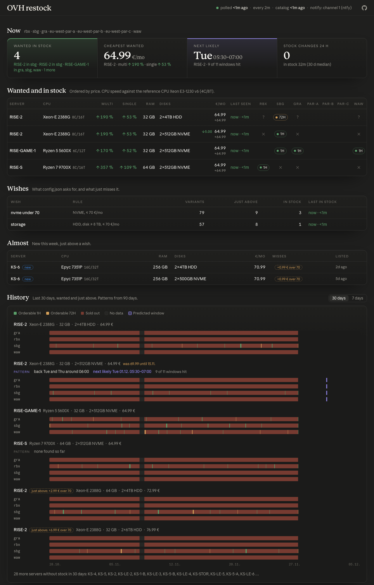

# OVH restock

*Completely over-engineered, but cool: an LLM predicts when your 15 € server will be back.*

Get a push the minute an OVHcloud dedicated server you want comes back into stock.

Kimsufi, So you Start, Rise and the bare-metal ranges sell out fast and restock without notice. OVH restock polls
OVH's public stock API every minute or two, matches every server configuration against the wishes you write down
(memory, disk, CPU, speed, price) and pushes the ones that just became orderable, with the order link. A status page
keeps the history: when each server was in stock and for how long, what its price did, and, when restocks follow a
rhythm, when the next one is likely.



The screenshot shows live stock with a sample history.

- **Wishes, not product codes.** `"disk": "nvme", "price_max_eur": 30, "ram_min_gb": 64`: every variant OVH sells in
  your datacenters is checked, prices include the RAM and disk options and the mandatory add-ons.
- **Pushed once.** A server is pushed when it comes into stock, not again while it stays; when it sells out and
  returns, it is pushed again. SMTP, ntfy, Pushover, Telegram and more (shoutrrr URLs); a leading `!` switches one
  off. Every start sends a test push to the channels that are on, except one that took one in the last 10 minutes.
- **How fast is it.** Cores, threads and the multi- and single-thread speed against a CPU of your choice, from
  PassMark figures. `cpu_min_pct` keeps out what is too slow.
- **History.** 30 or 7 days per server and datacenter, stock changes, price changes, and the servers just above a
  wish (one rule missed narrowly), which are tracked too.
- **Restock patterns (optional).** With an LLM configured, servers that restock often enough are checked for a
  rhythm ("back Tue and Thu around 06:00"). The model only proposes: the code drops any pattern the counted restocks
  don't bear out, so no pattern is shown as none. A weekly digest and `-wish` (a wish in plain words) come with it.
- **One container**, no database, no login: the page is read-only.

## Setup

Behind an existing Traefik (network `traefik`, entrypoint `websecure`):

```sh
mkdir ovh-restock && cd ovh-restock
curl -fsSLO https://raw.githubusercontent.com/trick77/ovh-restock/master/compose.yaml
curl -fsSL https://raw.githubusercontent.com/trick77/ovh-restock/master/.env.example -o .env
mkdir -p data conf
curl -fsSL https://raw.githubusercontent.com/trick77/ovh-restock/master/config.example.json -o conf/config.json
sudo chown -R 65532:65532 data conf
# set PUBLIC_FQDN and BACKEND_NOTIFY_URLS in .env, your wishes in conf/config.json
docker compose run --rm ovh-restock -notify-test
docker compose up -d
```

[`.env.example`](.env.example) explains every variable.

## Wishes

`conf/config.json`:

```json
{
  "datacenters": ["rbx", "sbg", "gra", "eu-west-par-a", "eu-west-par-b", "eu-west-par-c", "waw"],
  "interval": "2m",
  "reference_cpu": "Intel Xeon E3-1230 v6",
  "want": [
    { "name": "small nvme", "ram_max_gb": 64, "disk": "nvme", "price_max_eur": 30, "cpu_min_pct": -10 },
    { "name": "storage box", "disk": "hdd", "disk_min_tb": 8, "price_max_eur": 40 }
  ]
}
```

A wish takes a server when every rule it sets holds; any wish taking it is enough.

| Rule | Means |
| --- | --- |
| `ram_min_gb`, `ram_max_gb` | memory in GB |
| `disk` | `nvme`, `ssd` or `hdd`: at least one disk group of that kind |
| `disk_min_tb` | raw disk in TB, of `disk`'s kind when set |
| `cpu` | part of the CPU name, any case (`epyc`, `ryzen`, `xeon-e`) |
| `cpu_min_pct` | multithread speed against `reference_cpu` in percent: `-10` is at most 10 % slower |
| `price_max_eur` | monthly price in EUR, net of VAT, from the FR catalog |

Unknown keys are refused, so a typo can't widen a wish. `-wish "nvme, 64 GB, under 30 €"` writes a block for you
(needs the LLM).

## Development

```sh
mkdir -p data conf && cp config.example.json conf/config.json
BACKEND_DATA_DIR=./data BACKEND_CONF_DIR=./conf BACKEND_ADDR=127.0.0.1:8080 go run .
make check   # the full gate (ship)
```

The LLM evals cost money and run only on request: see `internal/predict/eval_test.go`.
