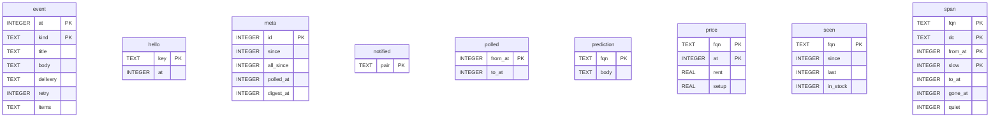

<!-- Generated by github.com/trick77/ship/kit/schemadoc, do not edit. Regenerate in the Go module directory: SCHEMADOC_UPDATE=1 go test ./... -run TestSchemaDoc -->

# Database schema

9 tables; the diagram is at the end. Go types are the `model.go` structs whose rows they hold.

## event

Go types:

- `watch.Event` (internal/watch): Event is a restock or a weekly digest, whether a channel took it or not. At and Kind name it: one of each per poll at most.

| Column | Type | Null | Default | PK |
| --- | --- | --- | --- | --- |
| `at` | INTEGER | no |  | 1 |
| `kind` | TEXT | no |  | 2 |
| `title` | TEXT | no |  |  |
| `body` | TEXT | no |  |  |
| `delivery` | TEXT | no |  |  |
| `retry` | INTEGER | no |  |  |
| `items` | TEXT | yes |  |  |

## hello

| Column | Type | Null | Default | PK |
| --- | --- | --- | --- | --- |
| `key` | TEXT | no |  | 1 |
| `at` | INTEGER | no |  |  |

## meta

| Column | Type | Null | Default | PK |
| --- | --- | --- | --- | --- |
| `id` | INTEGER | no |  | 1 |
| `since` | INTEGER | yes |  |  |
| `all_since` | INTEGER | yes |  |  |
| `polled_at` | INTEGER | yes |  |  |
| `digest_at` | INTEGER | yes |  |  |

Checks:

- `CHECK (id = 1)`

## notified

| Column | Type | Null | Default | PK |
| --- | --- | --- | --- | --- |
| `pair` | TEXT | no |  | 1 |

## polled

| Column | Type | Null | Default | PK |
| --- | --- | --- | --- | --- |
| `from_at` | INTEGER | no |  | 1 |
| `to_at` | INTEGER | yes |  |  |

## prediction

| Column | Type | Null | Default | PK |
| --- | --- | --- | --- | --- |
| `fqn` | TEXT | no |  | 1 |
| `body` | TEXT | no |  |  |

## price

Go types:

- `watch.Price` (internal/watch): Price is a variant's catalog price from At on.

| Column | Type | Null | Default | PK |
| --- | --- | --- | --- | --- |
| `fqn` | TEXT | no |  | 1 |
| `at` | INTEGER | no |  | 2 |
| `rent` | REAL | no |  |  |
| `setup` | REAL | no |  |  |

## seen

Go types:

- `watch.Seen` (internal/watch): Seen is one variant's stock streak, in any watched DC. Last is NULL in the row while it is in stock at the last poll (meta.polled_at).

| Column | Type | Null | Default | PK |
| --- | --- | --- | --- | --- |
| `fqn` | TEXT | no |  | 1 |
| `since` | INTEGER | no |  |  |
| `last` | INTEGER | yes |  |  |
| `in_stock` | INTEGER | no |  |  |

## span

Go types:

- `watch.Span` (internal/watch): Span is a stretch of time: a pair in stock (table span), or polls running (table polled, From and To only). Slow: orderable with 72H delivery rather than 1H. Gone is the poll that found it sold out; zero while open or when polling stopped. Quiet: nobody saw it come in (first poll after a start, after a gap), so the log has no "in" for it. To is NULL in the row while open at the last poll (meta.polled_at).

| Column | Type | Null | Default | PK |
| --- | --- | --- | --- | --- |
| `fqn` | TEXT | no |  | 1 |
| `dc` | TEXT | no |  | 2 |
| `from_at` | INTEGER | no |  | 3 |
| `slow` | INTEGER | no |  | 4 |
| `to_at` | INTEGER | yes |  |  |
| `gone_at` | INTEGER | yes |  |  |
| `quiet` | INTEGER | no |  |  |

## Types not stored as rows

### watch.Item

In `internal/watch`. Item is one server of a restock event, kept as JSON in event.items.

| Field | Type | Doc |
| --- | --- | --- |
| `FQN` | `string` |  |
| `Name` | `string` |  |
| `PlanCode` | `string` |  |
| `CPU` | `string` |  |
| `RAM` | `int` |  |
| `Disks` | `[]string` |  |
| `Rent` | `float64` |  |
| `Priced` | `bool` |  |
| `OrderURL` | `string` |  |
| `DCs` | `[]ItemDC` |  |

### watch.ItemDC

In `internal/watch`. ItemDC is a DC a restock item came in at; Slow: 72H delivery.

| Field | Type | Doc |
| --- | --- | --- |
| `DC` | `string` |  |
| `Slow` | `bool` |  |

## Diagram

